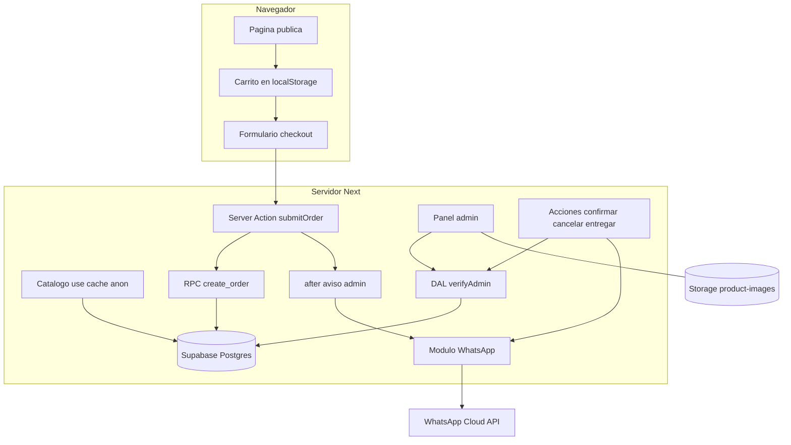

# Plan técnico: Tienda online "Buen Día"

Fase 3 (PLAN). Responde al **cómo** de [`spec.md`](spec.md). Los criterios se citan como `C1…C29`.
Reemplaza a [`dulce-despertar-plan.md`](../../dulce-despertar-plan.md) (ver "Cambios respecto del plan anterior").

## 1. Contexto verificado del código y de Next.js 16.4.6

| Hecho | Fuente | Consecuencia |
|---|---|---|
| Proyecto sin `src/`; alias `@/*` → raíz | `tsconfig.json` | Carpetas `app/`, `components/`, `lib/` en la raíz |
| `cacheComponents: true` y `partialPrefetching: true` ya activos | `next.config.ts` | Todo dato sin caché va dentro de `<Suspense>`; no se usa `Date.now()` en render de servidor |
| `.gitignore` ignora `.env*` completo | `.gitignore` línea 34 | Hay que agregar `!.env.example` |
| `middleware` se llama `proxy` (`proxy.ts` en la raíz, export `proxy`) | `proxy.md` | Proxy solo hace chequeo optimista; la autorización real va en el DAL |
| `use cache` no puede leer `cookies()`/`headers()` | `use-cache.md` | El catálogo público cacheado usa un cliente Supabase **anónimo sin cookies** |
| `updateTag(tag)` solo en Server Actions; `revalidateTag(tag, 'max')` requiere 2.º argumento | `updateTag.md`, `revalidateTag.md` | Las acciones del admin usan `updateTag('products')` |
| Server Actions: POST público, límite de cuerpo 1 MB, CSRF por `Origin` | `server-actions.md` | Se tratan como endpoints públicos; se sube `bodySizeLimit` para imágenes |
| `after()` disponible en Server Actions | `after.md` | El aviso al admin no bloquea la respuesta al cliente |
| `next` 16.4.6, `react` 19.3.0, Tailwind 4.3.3 | `package.json` | El CSS de la referencia se porta a `globals.css` tal cual (CSS plano, sin reescribir en utilidades) |
| Versiones vigentes (npm, 2026-11) | `npm view` | `@supabase/supabase-js` 2.119.0, `@supabase/ssr` 0.12.7, `zod` 4.6.7, `vitest` 5.1.0; todos con publicación reciente |

## 2. Arquitectura



Principios:
1. **El servidor es la única fuente de verdad de precios, totales y disponibilidad** (C7, C16). El cliente envía solo `productId`, `qty` y mensajes.
2. **Sin cliente Supabase en el navegador.** Todo acceso a datos ocurre en servidor; el login del admin es una Server Action. Así la clave anónima y la de servicio nunca llegan al bundle.
3. **Defensa en profundidad para el admin:** proxy (optimista) → DAL `verifyAdmin()` en cada página y acción → RLS en la base.
4. **Escritura de pedidos solo con la secret key (rol `service_role`)**, dentro de una función SQL transaccional; `anon` no tiene permiso de escritura en `orders`.
5. Un fallo de WhatsApp nunca revierte ni pierde un pedido (C23).

## 3. Estructura de archivos

```
app/
  layout.tsx, globals.css, page.tsx          # tienda pública
  admin/layout.tsx                           # noindex, sin enlaces desde el sitio público
  admin/login/page.tsx
  admin/page.tsx                             # pedidos
  admin/productos/page.tsx, [id]/page.tsx, nuevo/page.tsx
components/
  store/  Header, Hero, Steps, ProductSection, ProductCard, MotiveChips, Band, Footer
  cart/   CartProvider, CartDrawer, CartStep, CheckoutStep, DoneStep, Personalization
  admin/  OrdersList, OrderCard, OrderCountdown, ProductForm, ProductsTable
lib/
  config.ts                                  # constantes de negocio (C7, C13)
  domain/ money.ts phone.ts slots.ts pricing.ts order-schema.ts messages.ts
  supabase/ publishable.ts server.ts secret.ts
  dal.ts                                     # verifyAdmin, getOrders, getAllProducts
  catalog.ts                                 # getCatalog() con use cache
  whatsapp.ts                                # envío + registro
  actions/ orders.ts (submitOrder) admin-orders.ts admin-products.ts auth.ts
proxy.ts
supabase/migrations/0001_init.sql, supabase/seed.sql
.env.example
```

## 4. Contratos

### 4.1 Constantes (`lib/config.ts`) — fijas por spec
- `TZ_OFFSET = "-03:00"` (Argentina no usa horario de verano; los horarios se interpretan siempre en hora argentina aunque el servidor corra en UTC).
- `MIN_LEAD_HOURS = 12`, `SHIPPING_FEE = 3000`, `MAX_PER_PRODUCT = 20`, `MAX_TOTAL = 50`, `MESSAGE_MAX = 150`, `NOTE_MAX = 300`.
- `SLOTS` = las 8 franjas de la spec; `PERSONALIZABLE_SECTIONS = ["desayunos","tortas"]`.
- `STORE`: nombre, dirección del local (placeholder editable en código), `PAYMENT_ALIAS = "BUENDIA.DESAYUNOS"`.

### 4.2 Esquema (`supabase/migrations/0001_init.sql`)

| Tabla | Columnas clave |
|---|---|
| `products` | `id uuid pk`, `name`, `description`, `price int check > 0`, `section` enum(`desayunos`,`tortas`,`dulces`), `motive text null`, `image_url text`, `status` enum(`active`,`unavailable`,`hidden`), `sort_order int`, `created_at`, `updated_at` |
| `orders` | `id bigint identity (inicia en 1001)`, `customer_name`, `customer_phone` (10 dígitos), `delivery_type` enum(`domicilio`,`retiro`), `address null`, `delivery_at timestamptz`, `delivery_slot text`, `note null`, `subtotal int`, `shipping_fee int`, `total int`, `status` enum(`pendiente`,`confirmado`,`entregado`,`cancelado`), `created_at`, `confirmed_at null`, `check(delivery_type='domicilio' → address not null)`, `check(total = subtotal + shipping_fee)` |
| `order_items` | `id`, `order_id fk`, `product_id fk (on delete restrict)`, `product_name`, `section`, `unit_price`, `qty int check 1..20`, `messages jsonb` (array de strings, longitud ≤ `qty`; `[]` si no hay) |
| `whatsapp_messages` | `id`, `order_id fk`, `kind` enum(`admin_new_order`,`customer_confirmed`,`customer_cancelled`), `status` enum(`sent`,`failed`), `error_code null`, `attempts int`, `created_at`, `sent_at null` |

- Los productos **nunca se borran físicamente** (`on delete restrict`); "baja" = `status='hidden'` (C28). Nombre y precio se copian a `order_items` (C27).
- **RPC `create_order(...)`** (`security definer`, `execute` revocado a `anon` y `authenticated`, concedido solo a `service_role`): dentro de una transacción lee los productos por id con `for share`, rechaza si alguno no existe o no está `active` (devuelve la lista de nombres afectados, C16), valida cantidades y mensajes, calcula `subtotal`, `shipping_fee`, `total` (C7), inserta `orders` + `order_items` y devuelve `{id, total}`. También aplica el límite anti-abuso (ver §6).
- **Transiciones de estado** como `update … where id = $1 and status = 'pendiente'` (confirmar/cancelar) y `… and status = 'confirmado'` (entregar): atómicas, evitan doble confirmación y doble mensaje.

### 4.3 RLS y Storage
- `products`: `select` para `anon` solo con `status in ('active','unavailable')`; `insert/update` para admin. Sin `delete` para nadie.
- `orders`, `order_items`, `whatsapp_messages`: **sin** políticas para `anon`; `select/update` solo admin. Insert únicamente vía RPC con la secret key.
- Admin = `auth.jwt() -> 'app_metadata' ->> 'role' = 'admin'`. `app_metadata` solo lo modifica el servidor/dashboard, no el propio usuario (a diferencia de `user_metadata`). Se asigna con un `update auth.users set raw_app_meta_data = …` documentado en el README.
- Bucket `product-images`: lectura pública; escritura/borrado solo admin; límite de 2 MB y tipos `image/jpeg|png|webp` configurados en el bucket.

### 4.4 Server Actions (todas validan con `zod`; devuelven errores genéricos, nunca excepciones de BD)

| Acción | Quién | Entrada | Salida |
|---|---|---|---|
| `submitOrder(prev, formData)` | público | `cart` (JSON: `[{productId, qty, messages[]}]`), `name`, `phone`, `deliveryType`, `address`, `date`, `slot`, `note`, `website` (honeypot) | `{ok:true, order:{id,total,…}}` ó `{ok:false, fieldErrors, unavailable?:string[]}` |
| `login(prev, formData)` | público | email, clave | redirige a `/admin` ó error genérico "Credenciales inválidas" |
| `logout()` | admin | — | redirige a `/admin/login` |
| `confirmOrder(id)` | admin | id | actualiza estado → envía plantilla → `{ok, whatsapp:'sent'|'failed'}` |
| `cancelOrder(id)` | admin | id | idem con plantilla de disculpas |
| `markDelivered(id)` | admin | id | `{ok}` |
| `retryWhatsapp(orderId, kind)` | admin | — | `{ok}` |
| `saveProduct`, `setProductStatus`, `uploadProductImage` | admin | datos validados | `{ok}`; llaman `updateTag('products')` |

Validaciones servidor de `submitOrder` (orden): honeypot vacío → carrito no vacío, ≤ 20 por producto y ≤ 50 total (C8) → mensajes solo en secciones personalizables, uno por unidad como máximo, ≤ 150 caracteres (C9) → nombre ≥ 2 (C11) → teléfono (C12) → dirección si domicilio (C10) → fecha/franja válidas y `inicio de franja ≥ ahora + 12 h` (C13) → RPC.

### 4.5 Reglas puras (`lib/domain`) — núcleo testeable
- `normalizePhone(input)`: quita espacios, guiones y paréntesis; exige exactamente 10 dígitos y que no empiece en `0`; devuelve 10 dígitos o `null`. `toWhatsappId(d)` = `"549" + d`. Ej.: `351-3445566` → `3513445566` → `5493513445566`. Se rechazan el prefijo `0`, `15` y el `+54`, por la interpretación aprobada en la spec.
- `slotStart(date, slot)` = `new Date(`${date}T${HH}:00:00-03:00`)`. `isSlotAllowed(date, slot, now)` = `slotStart − now ≥ 12 h` (exactamente 12 h es válido; ejemplo de C13: lunes 20:00 → primera franja martes 08:00–09:00).
- `computeTotals(items, deliveryType)` = `subtotal` + (`SHIPPING_FEE` si domicilio).
- `buildMessages` (texto de WhatsApp) para los tres tipos de aviso.

### 4.6 Catálogo y caché
- `getCatalog()` con `'use cache'`, `cacheTag('products')`, `cacheLife('minutes')`. Usa `lib/supabase/publishable.ts` (`createClient` sin cookies). Los productos `hidden` no llegan por RLS (C3); los `unavailable` llegan con su estado (C2).
- Las acciones de admin llaman `updateTag('products')` para que el cambio se vea de inmediato (C26).
- El motivo se deriva de los datos; chips = `["Todos", …motivos distintos de la sección]` (C4).

### 4.7 Carrito (cliente)
- `CartProvider` con `useReducer` + persistencia en `localStorage`, hidratada tras montar para evitar diferencias de hidratación. Estado: `{ [productId]: { qty, messages: string[] } }`.
- Reductor puro con topes de C8 y recorte de `messages` si baja `qty`. Se concilia con el catálogo al cargar (descarta productos que ya no existan o no estén activos).
- El drawer, los pasos y los textos replican la referencia (`resources/index/index.html` líneas 260–424).
- Campos nuevos respecto de la referencia: línea de envío en el resumen (C7), bloque "Agregar mensaje personalizado" por unidad (C9), medios de pago en la pantalla final (C14).
- Disponibilidad de franjas: el cliente calcula con la hora actual **tras montar** (no en render de servidor) solo para UX; la regla real se valida en servidor.

### 4.8 WhatsApp (`lib/whatsapp.ts`)
- `POST https://graph.facebook.com/{WHATSAPP_API_VERSION}/{WHATSAPP_PHONE_NUMBER_ID}/messages`, `Authorization: Bearer ${WHATSAPP_TOKEN}`, `AbortSignal.timeout(8000)`, tipo `template`, idioma `es_AR`.
- Plantillas a registrar en Meta: `pedido_nuevo_admin`, `pedido_confirmado`, `pedido_cancelado`. Cada envío escribe una fila en `whatsapp_messages` (estado, código de error, intentos).
- Los parámetros de plantilla van en una sola línea (`·` como separador de ítems): Meta limita los saltos de línea en parámetros; **confirmar las restricciones exactas al registrar las plantillas**.
- El aviso al admin se dispara con `after()` tras crear el pedido (C17). La confirmación y la cancelación se esperan (`await`) para mostrar el resultado en el panel (C23).
- Registro: JSON estructurado, teléfonos enmascarados (`******4567`), nunca token ni cuerpo del mensaje.

### 4.9 Autenticación y panel
- `lib/supabase/server.ts`: `createServerClient` de `@supabase/ssr` con `cookies()`.
- `verifyAdmin()` en el DAL: `supabase.auth.getUser()` (valida contra el servidor de Auth, no solo decodifica la cookie) y exige `app_metadata.role === 'admin'`; si no, `redirect('/admin/login')`. Se invoca en cada página `/admin/*` y al inicio de cada acción de admin.
- `proxy.ts` con `matcher: ['/admin/:path*']`: refresca la sesión y redirige a `/admin/login` si no hay usuario. No es la barrera de seguridad (el DAL y RLS lo son).
- Páginas admin: dinámicas, dentro de `<Suspense>` (leen cookies). `export const metadata = { robots: { index: false } }`.
- C19: ningún componente público enlaza a `/admin`; `/admin/login` solo se conoce por URL. No se agrega `robots.txt` con `Disallow: /admin` para no publicar la ruta.
- Contador de 30 min: `OrderCountdown` (cliente) calcula `created_at + 30 min − ahora` cada 30 s. El listado se refresca con `router.refresh()` cada 30 s (polling, sin Realtime).
- Las acciones de admin usan el cliente con la sesión del usuario (RLS vigente). Solo `submitOrder` usa la secret key.

## 5. Estrategia de pruebas

Herramientas: `vitest` para lógica pura y acciones con dependencias simuladas; verificación manual guiada para integración con Supabase/Meta; `npm run lint` y `npm run build` al cierre de cada tarea.

| Criterio | Prueba |
|---|---|
| C1–C4 | Manual con datos semilla + unit de `groupMotives`; comprobar con `anon` que un producto `hidden` no se lee |
| C5, C8, C9 | Unit del reductor del carrito: topes 20/50, recorte de mensajes, dulces sin mensajes |
| C6 | Unit: el paso "Datos" no es alcanzable con carrito vacío; manual |
| C7 | Unit `computeTotals` (domicilio / retiro) + test de la RPC comparando total registrado vs. mostrado |
| C10–C13 | Unit del esquema zod con casos: sin dirección, nombre vacío, teléfonos `351-3445566` ✔, `0351…` ✘, `15…` ✘, 9 dígitos ✘; franjas con `now` fijo: exactamente 12 h ✔, 11 h 59 ✘, ejemplo del lunes 20:00 |
| C14, C15 | Manual: pedido válido deja `pendiente`, vacía carrito, muestra id y medios de pago; sin pantallas de registro |
| C16 | Manual: pasar un producto a `unavailable` con el carrito armado y confirmar → rechazo con nombre |
| C17, C21–C23 | Unit de `whatsapp.ts` con `fetch` simulado (éxito, error HTTP, timeout) + prueba real con número de prueba de Meta |
| C18 | Manual: sin sesión `/admin` → login; con la publishable key por PostgREST `select` en `orders` → vacío/denegado |
| C19 | `grep` del HTML de `/` y del bundle: sin "admin" |
| C20, C25 | Manual con pedidos de prueba; unit del cálculo `Quedan X min / Demorado X min` |
| C24 | Manual + prueba de transición inválida (entregar un `pendiente` falla) |
| C26–C28 | Manual: alta con imagen visible; cambiar precio no altera pedido viejo; baja no rompe el panel de pedidos |
| C29 | Revisión visual contra la referencia en 360 px, 768 px y 1280 px |
| Seguridad | Tras `next build`, buscar `sb_secret_`, `SUPABASE_SECRET_KEY` y el token de Meta en `.next/static` (debe dar 0 coincidencias); doble envío del mismo `confirmOrder` envía un solo mensaje |

## 6. Riesgos y decisiones

| Riesgo | Decisión |
|---|---|
| Plantillas de Meta pendientes de aprobación | El envío puede fallar sin romper el flujo: queda `failed` en `whatsapp_messages` y el botón "Reintentar" aparece en el panel. Entregable de arranque: textos de plantilla en el README |
| Mensajes de plantilla solo a una línea | Los ítems se resumen con `·`; el detalle completo está en el panel |
| Abuso del formulario público (sin cuenta) | Honeypot + límite en la RPC: máximo 3 pedidos `pendiente` por teléfono por hora y máximo 60 pedidos por hora en total. Un límite por IP requiere un almacén externo (Redis) y queda fuera por ahora |
| Hidratación del carrito en `localStorage` | Se lee tras montar; el contador muestra 0 hasta entonces |
| Husos horarios (servidor en UTC) | Todas las fechas se construyen con offset fijo `-03:00`; la columna es `timestamptz` |
| `bodySizeLimit` por defecto de 1 MB | Subir a `3mb` en `next.config.ts` para imágenes de hasta 2 MB; validación de tipo y tamaño también en servidor |
| Dos admins confirman el mismo pedido | `update … where status='pendiente'` devuelve 0 filas al segundo; no se envía un segundo mensaje |
| Cancelar un pedido ya confirmado | Fuera de alcance: cancelar solo desde `pendiente`, para no enviar una disculpa tras haber prometido la entrega |
| `.env.example` ignorado por git | Agregar `!.env.example` a `.gitignore` |
| Cambio de versiones de la API de Graph | `WHATSAPP_API_VERSION` como variable de entorno |

## 7. Cambios respecto del plan anterior (`dulce-despertar-plan.md`)

1. Regla de 12 horas para todos los pedidos (reemplaza "24 h para tortas" de la referencia).
2. Costo de envío fijo de $3.000 en `orders.shipping_fee` y en los totales.
3. Mensaje personalizado por unidad: `order_items.messages`.
4. Se quita todo enlace público al panel, incluido el pie con "Panel administrador (demo)".
5. Se agrega el aviso de cancelación (plantilla `pedido_cancelado`) y la tabla `whatsapp_messages` para reintentos.
6. Creación de pedido en una función SQL transaccional en lugar de insertar desde la acción.
7. Sin cliente Supabase en el navegador; `image_url` en lugar de `image_path`.
8. Se adapta a `cacheComponents` (catálogo con `use cache`, panel admin dentro de `<Suspense>`) y a `proxy`, `updateTag`, `revalidateTag(tag,'max')`.
9. Se quitan el email y las variables de email.
10. Pruebas automáticas con `vitest` para la lógica pura.

## 8. Variables de entorno (`.env.example`, valores vacíos)

`NEXT_PUBLIC_SUPABASE_URL`, `NEXT_PUBLIC_SUPABASE_PUBLISHABLE_KEY`, `SUPABASE_SECRET_KEY` (solo servidor), `WHATSAPP_TOKEN` (solo servidor), `WHATSAPP_PHONE_NUMBER_ID`, `WHATSAPP_API_VERSION`, `ADMIN_WHATSAPP` (10 dígitos), `NEXT_SERVER_ACTIONS_ENCRYPTION_KEY` (solo si se despliega en varias instancias).
